# Tutorial 9 — Java Swing (MVC) & JDBC

**Course:** 21CSC203P – Advanced Programming Practice  
**Tutorial date:** 01-10-2026

| Q | Topic | Folder |
|---|-------|--------|
| 1 | Student Grade Calculator (Java Swing + MVC) | [`Q1_StudentGradeCalculator`](Q1_StudentGradeCalculator/) |
| 2 | Vehicle Service Cost Estimator (Java Swing + MVC) | [`Q2_VehicleServiceCostEstimator`](Q2_VehicleServiceCostEstimator/) |
| 3 | Employee Management Portal (Java Swing + MVC) | [`Q3_EmployeeManagementPortal`](Q3_EmployeeManagementPortal/) |
| 4 | Library – Book table (JDBC + MySQL) | [`Q4_LibraryJDBC`](Q4_LibraryJDBC/) |
| 5 | Store – Product table (JDBC + MySQL) | [`Q5_ProductStoreJDBC`](Q5_ProductStoreJDBC/) |
| 6 | College – CourseRegistration table (JDBC + MySQL) | [`Q6_CourseRegistrationJDBC`](Q6_CourseRegistrationJDBC/) |

## Q1. Student Grade Calculator (Java Swing + MVC)

Student enters name and marks in three subjects. **Calculate Result** shows total, average and grade (A ≥ 90, B 75–89, C 60–74, D 50–59, F < 50).

**Files:** `StudentModel` (calculation + data) · `StudentView` (Swing UI) · `StudentController` (button handling) · `StudentGradeApp` (main)

**Run:**
```bash
cd Q1_StudentGradeCalculator
javac *.java
java StudentGradeApp
```

**Output:**

*Average 76.33 → Grade B*  
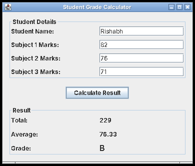

*Average 94.67 → Grade A*  
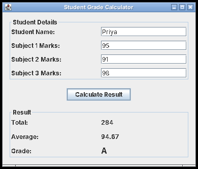

*Average 47.00 → Grade F*  


*Validation for non-numeric marks*  
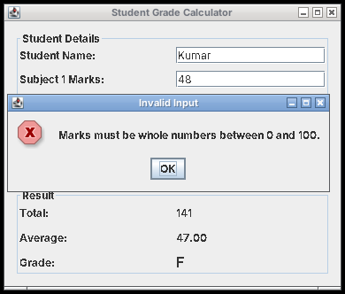

## Q2. Vehicle Service Cost Estimator (Java Swing + MVC)

Registration number, vehicle type (JRadioButton) and services (JCheckBox): General Service ₹1,000, Oil Change ₹800, Brake Service ₹1,200, Battery Check ₹500. **Calculate Cost** shows the total.

**Files:** `VehicleServiceModel` · `VehicleServiceView` · `VehicleServiceController` · `VehicleServiceApp` (main)

**Run:**
```bash
cd Q2_VehicleServiceCostEstimator
javac *.java
java VehicleServiceApp
```

**Output:**

*Car – General Service + Oil Change + Brake Service*  
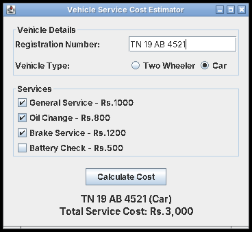

*Two Wheeler – General Service + Battery Check*  
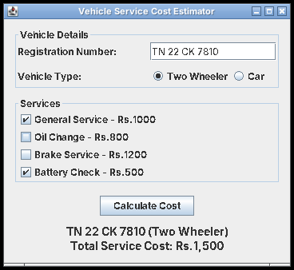

*Validation when no service is selected*  
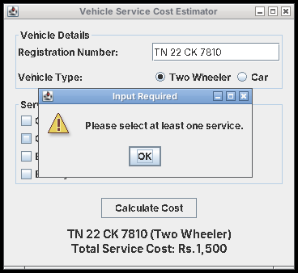

## Q3. Employee Management Portal (Java Swing + MVC)

Login window (JPasswordField, valid login `admin` / `admin123`, JOptionPane messages), then a main window with menus **Employee** (Add / View), **Tools** (Change Password) and **Exit** (Logout / Exit Application).

**Files:** `Employee`, `EmployeeModel` · `LoginView`, `MainView` · `EmployeeController` · `EmployeePortalApp` (main)

**Run:**
```bash
cd Q3_EmployeeManagementPortal
javac *.java
java EmployeePortalApp
```

**Output:**

*Invalid credentials*  
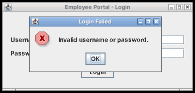

*Login window (admin / admin123)*  
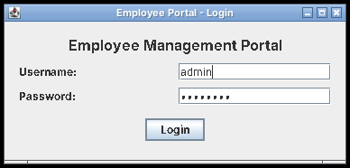

*Successful login message*  
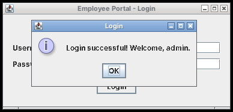

*Main window after login*  
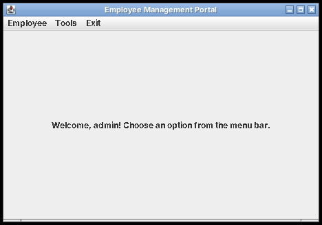

*Employee menu*  
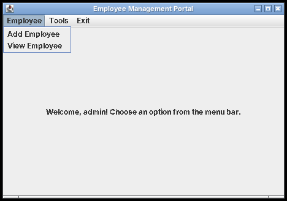

*Add Employee form*  
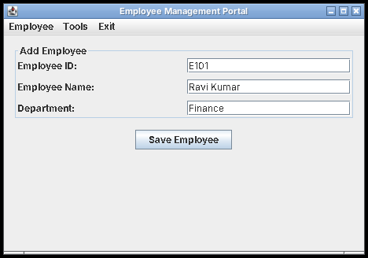

*Employee saved*  
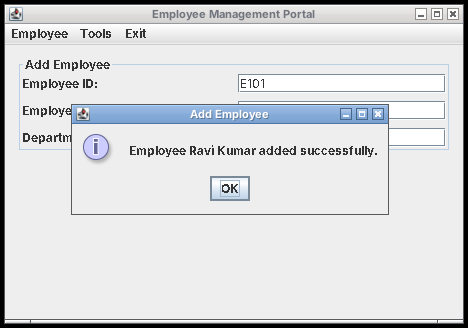

*View Employee*  
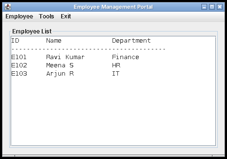

*Tools menu*  
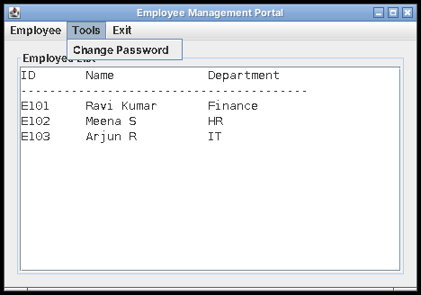

*Change Password – new and confirm do not match*  
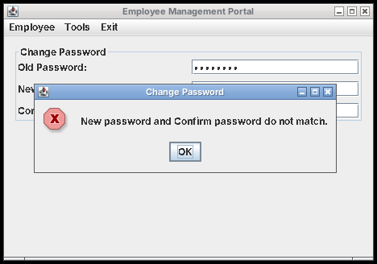

*Change Password – success*  
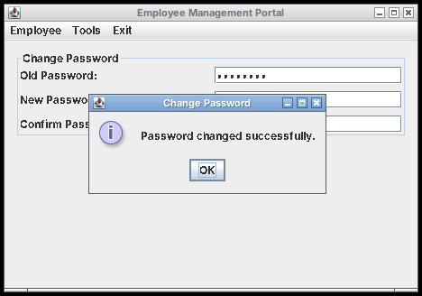

*Exit menu (Logout / Exit Application)*  
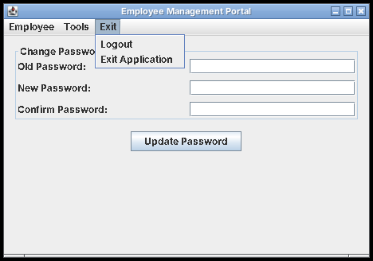

*Back to Login Window after Logout*  
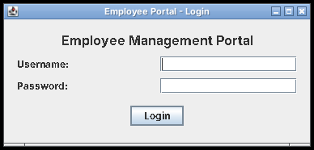

## JDBC programs (Q4–Q6)

**Setup:** run each question's `.sql` file in MySQL first, then compile and run with the MySQL Connector/J jar on the classpath. The programs connect with user `root`, password `root` — change the `PASSWORD` constant to your own MySQL password.

```bash
mysql -u root -p < library_setup.sql
javac LibraryManagement.java
java -cp ".:mysql-connector-j-8.4.0.jar" LibraryManagement     # use ; instead of : on Windows
```

## Q4. Library – Book table (JDBC + MySQL)

Menu-driven program to insert a book, search by Book ID, display all available books and mark a book as issued.

**Files:** `LibraryManagement.java`, `library_setup.sql`

**Output:**

```text
$ java -cp ".:mysql-connector-j.jar" LibraryManagement
Connected to library_db successfully.

===== LIBRARY MENU =====
1. Insert a new book
2. Search book by Book ID
3. Display all available books
4. Issue a book (change availability)
5. Exit
Enter your choice: 3
BookID  Title                        Author                     Price  Availability
----------------------------------------------------------------------------------
101     Let Us C                     Yashavant Kanetkar        399.00  Available
102     Head First Java              Kathy Sierra              650.00  Available
104     Database System Concepts     Abraham Silberschatz      925.00  Available

===== LIBRARY MENU =====
1. Insert a new book
2. Search book by Book ID
3. Display all available books
4. Issue a book (change availability)
5. Exit
Enter your choice: 1
Enter Book ID: 105
Enter Title: Introduction to Algorithms
Enter Author: Thomas H. Cormen
Enter Price: 1450
1 book inserted successfully.

===== LIBRARY MENU =====
1. Insert a new book
2. Search book by Book ID
3. Display all available books
4. Issue a book (change availability)
5. Exit
Enter your choice: 2
Enter Book ID to search: 105
BookID  Title                        Author                     Price  Availability
----------------------------------------------------------------------------------
105     Introduction to Algorithms   Thomas H. Cormen         1450.00  Available

===== LIBRARY MENU =====
1. Insert a new book
2. Search book by Book ID
3. Display all available books
4. Issue a book (change availability)
5. Exit
Enter your choice: 2
Enter Book ID to search: 110
No book found with ID 110.

===== LIBRARY MENU =====
1. Insert a new book
2. Search book by Book ID
3. Display all available books
4. Issue a book (change availability)
5. Exit
Enter your choice: 4
Enter Book ID to issue: 102
Book 102 issued. Availability changed to 'Issued'.

===== LIBRARY MENU =====
1. Insert a new book
2. Search book by Book ID
3. Display all available books
4. Issue a book (change availability)
5. Exit
Enter your choice: 4
Enter Book ID to issue: 103
Book 103 does not exist or is already issued.

===== LIBRARY MENU =====
1. Insert a new book
2. Search book by Book ID
3. Display all available books
4. Issue a book (change availability)
5. Exit
Enter your choice: 3
BookID  Title                        Author                     Price  Availability
----------------------------------------------------------------------------------
101     Let Us C                     Yashavant Kanetkar        399.00  Available
104     Database System Concepts     Abraham Silberschatz      925.00  Available
105     Introduction to Algorithms   Thomas H. Cormen         1450.00  Available

===== LIBRARY MENU =====
1. Insert a new book
2. Search book by Book ID
3. Display all available books
4. Issue a book (change availability)
5. Exit
Enter your choice: 5
Exiting... Goodbye!
```

## Q5. Store – Product table (JDBC + MySQL)

Insert a product, retrieve by Product ID, update quantity and list products with quantity below 10, using `Connection`, `PreparedStatement` and `ResultSet`.

**Files:** `ProductStore.java`, `store_setup.sql`

**Output:**

```text
$ java -cp ".:mysql-connector-j.jar" ProductStore
Connected to store_db successfully.

===== STORE MENU =====
1. Insert a new product
2. Retrieve product by Product ID
3. Update product quantity
4. Display products with quantity below 10
5. Exit
Enter your choice: 1
Enter Product ID: 6
Enter Product Name: Mechanical Keyboard
Enter Price: 3499
Enter Quantity: 7
1 product inserted successfully.

===== STORE MENU =====
1. Insert a new product
2. Retrieve product by Product ID
3. Update product quantity
4. Display products with quantity below 10
5. Exit
Enter your choice: 2
Enter Product ID: 3
ProductID  ProductName               Price  Quantity
----------------------------------------------------
3          HDMI Cable               349.00        40

===== STORE MENU =====
1. Insert a new product
2. Retrieve product by Product ID
3. Update product quantity
4. Display products with quantity below 10
5. Exit
Enter your choice: 2
Enter Product ID: 99
No product found with ID 99.

===== STORE MENU =====
1. Insert a new product
2. Retrieve product by Product ID
3. Update product quantity
4. Display products with quantity below 10
5. Exit
Enter your choice: 3
Enter Product ID: 1
Enter new Quantity: 6
Quantity updated successfully.

===== STORE MENU =====
1. Insert a new product
2. Retrieve product by Product ID
3. Update product quantity
4. Display products with quantity below 10
5. Exit
Enter your choice: 4
Products with quantity below 10:
ProductID  ProductName               Price  Quantity
----------------------------------------------------
4          Laptop Stand            1299.00         5
1          Wireless Mouse           599.00         6
6          Mechanical Keyboard     3499.00         7
2          USB Keyboard             899.00         8

===== STORE MENU =====
1. Insert a new product
2. Retrieve product by Product ID
3. Update product quantity
4. Display products with quantity below 10
5. Exit
Enter your choice: 5
Exiting... Goodbye!
```

## Q6. College – CourseRegistration table (JDBC + MySQL)

Accepts a course code and lists every student registered for it; shows a message if nobody is registered.

**Files:** `CourseRegistrationSearch.java`, `college_setup.sql`

**Output:**

```text
$ java -cp ".:mysql-connector-j.jar" CourseRegistrationSearch
Enter Course Code: 21CSC203P

Students registered for 21CSC203P - Advanced Programming Practice:
StudentID          StudentName          Course     CourseName                       Semester
--------------------------------------------------------------------------------------------
S1001              Aditi Sharma         21CSC203P  Advanced Programming Practice    3
S1002              Karthik Raj          21CSC203P  Advanced Programming Practice    3
S1003              Nikhil Menon         21CSC203P  Advanced Programming Practice    3

Total students registered: 3

$ java -cp ".:mysql-connector-j.jar" CourseRegistrationSearch
Enter Course Code: 21CSC202J

Students registered for 21CSC202J - Operating Systems:
StudentID          StudentName          Course     CourseName                       Semester
--------------------------------------------------------------------------------------------
S1002              Karthik Raj          21CSC202J  Operating Systems                3
S1004              Sneha Iyer           21CSC202J  Operating Systems                3

Total students registered: 2

$ java -cp ".:mysql-connector-j.jar" CourseRegistrationSearch
Enter Course Code: 18CSE999T
No students are registered for the course code 18CSE999T.
```
